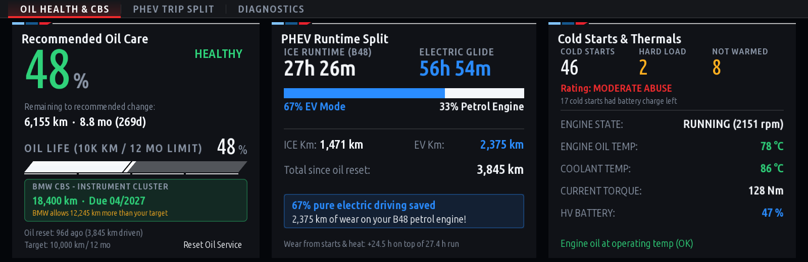
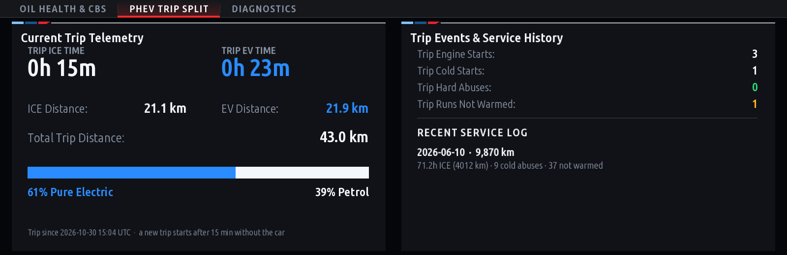
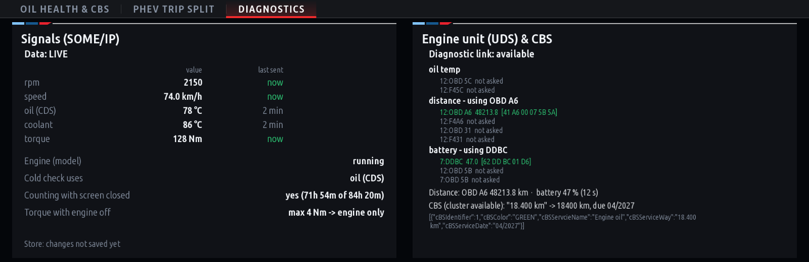
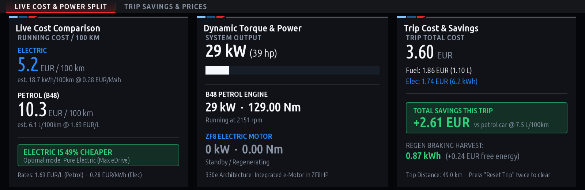
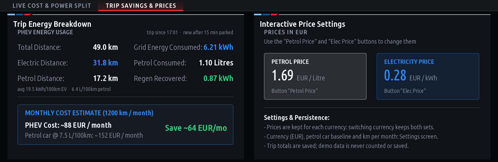
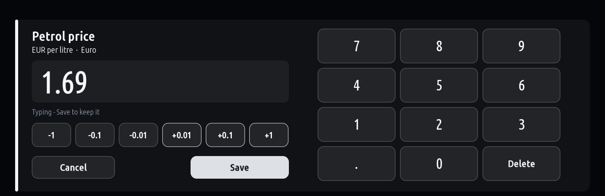

# BMW iDrive 7 Custom Apps (MGU)

Custom applications designed for BMW iDrive 7 (MGU head units) running on BMW PHEV models (B48 petrol engine + eDrive electric motor), compatible with **Robert Nisipeanu's mgu-store** and **IterioDev's App Manager**.

---

## 📱 Applications

### 1. ⚙️ Engine Care (`engine_care`)
*PHEV engine health and oil life intelligence monitor.*

BMW PHEV powertrains frequently start the combustion engine (ICE) directly while driving under hard acceleration, often when oil and coolant are completely cold. Standard BMW CBS (Condition Based Service) service intervals assume gentle highway mileage rather than intermittent short-cycle usage. **Engine Care** tracks real combustion engine telemetry to protect the engine:

* **Real Engine Operating Hours**: Tracks ICE runtime separate from EV driving.
* **ICE vs EV Mileage Split**: Percentage and absolute km driven on pure electric vs petrol.
* **Cold Hard-Start Counter**: Logs whenever the ICE starts while the engine oil is below the cold threshold (default < 65°C) and is then put under high torque load (default > 150 Nm) or above 3,200 rpm. The oil temperature comes from the CDS bus, or from the engine unit (OBD PID 5C) when the car doesn't send it there; the coolant temperature is the last fallback.
* **Real Distance**: Km since the oil change are read from the engine unit (OBD odometer PID A6, or PID 31), estimated from the speed only when it doesn't answer.
* **BMW CBS Side by Side**: Shows the instrument cluster's own oil service countdown (distance, date, overdue) next to your own target - for display only, as BMW's countdown is condition based and not a distance counter.
* **Engine Runs That Never Warmed the Oil**: Counts cold starts that stop again before the oil reaches its warm temperature (default 90°C) - the short PHEV runs that leave fuel and water in the oil.
* **Battery Charge at Engine Starts**: Splits engine starts into "the battery was at its reserve" and "it had charge left" (high-voltage battery charge read over UDS).
* **True Oil Life Monitor**: Whichever comes first of km, months and engine hours, plus wear counted in engine hours for cold starts, cold hard starts, runs that never warmed the oil and hot oil.
* **Configurable Thresholds**: Customizable service limits (120h–250h or 6,000–15,000 km), cold / warm temperatures, load threshold, battery reserve.
* **Diagnostics Page** (setting): every signal with its age, the engine unit's raw UDS answers, the cluster's raw CBS data, whether the app counts with its screen closed and whether the torque signal includes the e-motor.
* **Drive Recording** (setting): one line a second of what the app got from the car, to replay on a PC (see Development).




<sub>Screenshots drawn by the app on a PC (`tools/screenshots.js`) with sample data.</sub>

### 2. ⚡ Hybrid Cost (`hybrid_cost`)
*Real-time running cost & energy split calculator.*

Compare the financial and energy efficiency of electric vs petrol driving live on your central display:

* **Live Cost per 100 km**: Real-time monetary cost (e.g. RON/100km, EUR/100km) based on instant fuel and electricity consumption.
* **Dynamic Powertrain Torque Split**: Live visual split between ICE and Electric motor torque.
* **Price Editor**: Tap a price (or press "Petrol Price" / "Elec Price") and set it with the iDrive controller (turn to change, press to save), +/- buttons or a numeric keypad. Without the GPU renderer, the buttons step through round prices for the chosen currency.
* **Multi-Currency Support**: RON, EUR, USD, GBP, CHF, PLN, HUF, CZK, SEK, NOK, DKK - each with typical prices and its own decimals; prices are kept separately for every currency.
* **Trip Cost Summary**: Financial tracking for current trip, last charge, and cumulative usage.




<sub>Screenshots drawn by the app on a PC (`tools/screenshots.js`) with sample data.</sub>

---

## 🚀 Installation

### Method 1: Via mgu-store (Recommended)
1. Open **Store** on your BMW central display.
2. Go to **Settings** -> **Add repository**.
3. Enter:
   ```text
   github.com/aurelmarius/bmw-apps
   ```
4. Select **Releases** as the source type.
5. Tap **Install** next to **Engine Care** or **Hybrid Cost**.

### Method 2: Via USB Stick
1. Download `engine_care@<version>.tgz` and `hybrid_cost@<version>.tgz` from [Releases](https://github.com/aurelmarius/bmw-apps/releases).
2. Copy the files onto a USB stick or build a USB repository:
   ```powershell
   node mgu-install.js usb-repo E:\ engine_care@1.5.0.tgz hybrid_cost@1.0.2.tgz
   ```
3. Insert the USB drive into your car and install from the **USB** page of the Store.

### Method 3: Manual Deployment via SSH
Copy the package to the head unit and run `mgu-deploy.sh`:
```bash
/var/opt/mgu-deploy/mgu-deploy.sh install --artifact engine_care@1.5.0.tgz --yes
/var/opt/mgu-deploy/mgu-deploy.sh install --artifact hybrid_cost@1.0.2.tgz --yes
```

---

## 🛠️ Technical Details

* **Platform**: BMW MGU (Media Graphics Unit) / iDrive 7
* **Framework**: Node.js OAP SDK (`oap-sdk`), BMW RHMI UI descriptions
* **Renderer**: Hardware-accelerated GPU canvas (`mgu-renderd` / `mgu-render`)
* **Signals**: BMW CDS & CDS2 bus, SOME/IP Vehicle & FES services; UDS over the head unit's diagnostic link (TASU) for the engine unit (oil temperature, distance) and the battery unit (charge)
* **Kit**: `kit/` is the [iDrive 7 custom apps](https://github.com/cauliflowermossgrape/idrive7-apps) kit (MIT), with this repo's packaging changes for mgu-store in `kit/tools/build.py`

---

## 🧪 Development

```bash
python3 kit/tools/build.py engine_care hybrid_cost      # -> dist/<id>@<version>.tgz
node kit/tools/preview.js dist/engine_care preview      # what the app draws, as PNGs (demo data)
node tests/engine_care.test.js                          # Engine Care's model
node tests/engine_care_app.test.js                      # the app on a simulated head unit
node tools/replay_engine_care.js engine_care_drive.jsonl --events   # a drive recorded in the car
node tools/screenshots.js                               # the README's screenshots (after a build)
```

Engine Care's bookkeeping is in `apps/engine_care/model.js`; `main.js` reads the car and draws. A drive recorded in the car (setting "Record drive data", file `engine_care_drive.jsonl` in the app's data folder) can be replayed with other settings, e.g. `--set warmTarget=85`.

**Releasing**: build, copy the new `dist/*.tgz` into `packages/` (remove the old version of that app) and push. The push of `packages/` runs the *Prepare Draft Release* workflow, which updates `catalog.json` and creates a draft release; publish the draft to make it visible in the Store.

---

## 📄 License
Custom BMW Community Apps. Created for educational and enthusiast vehicle monitoring purposes.
