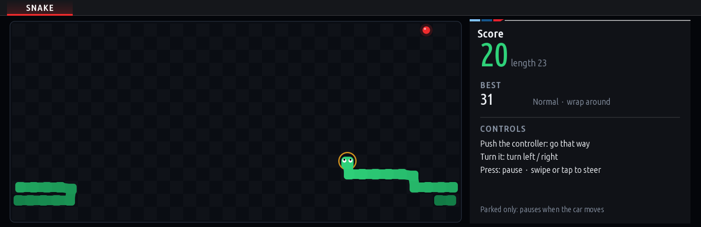
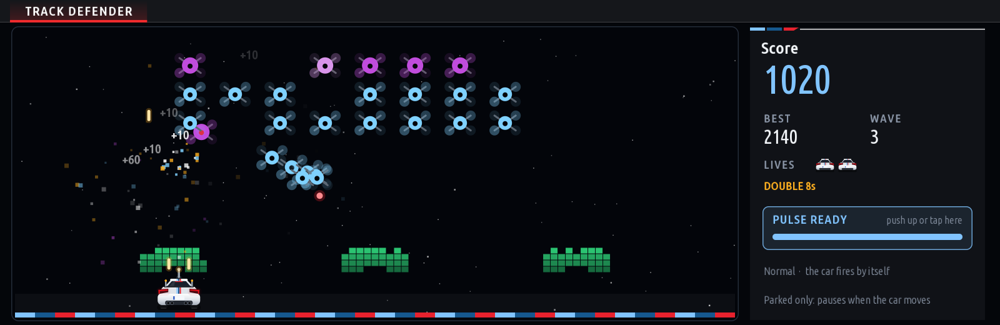
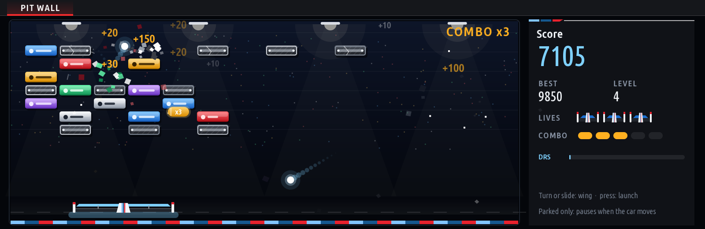
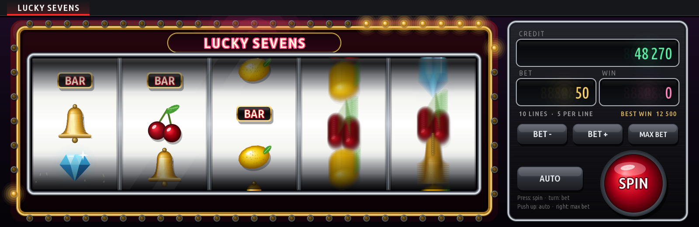
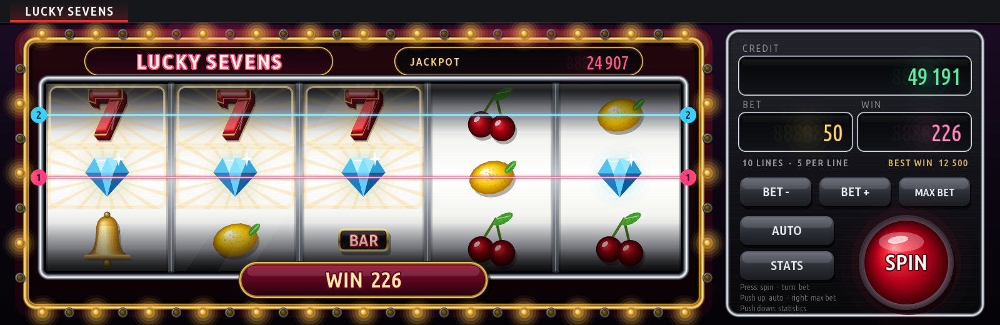
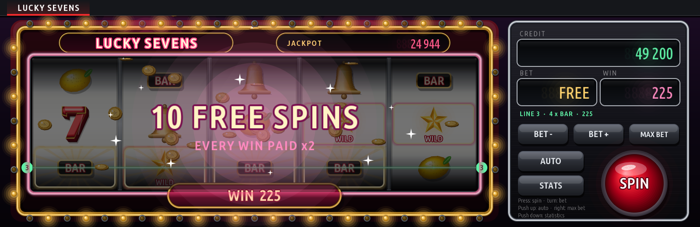
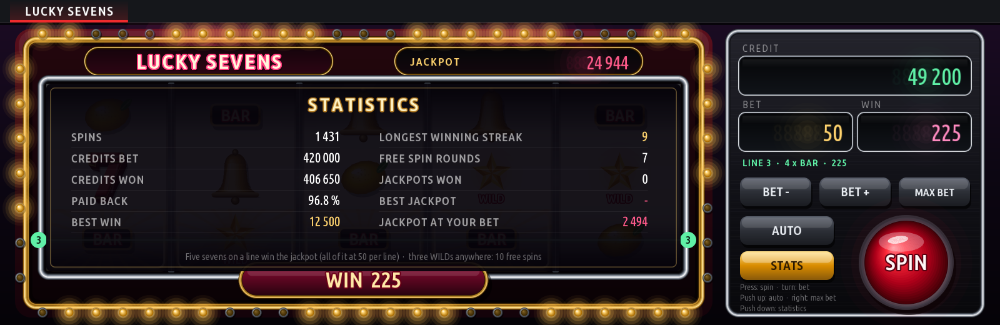
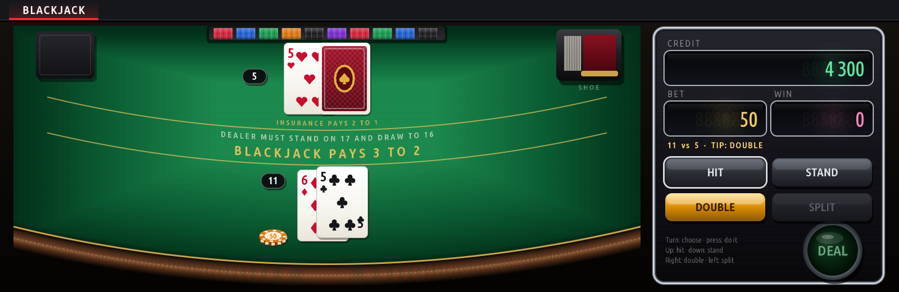
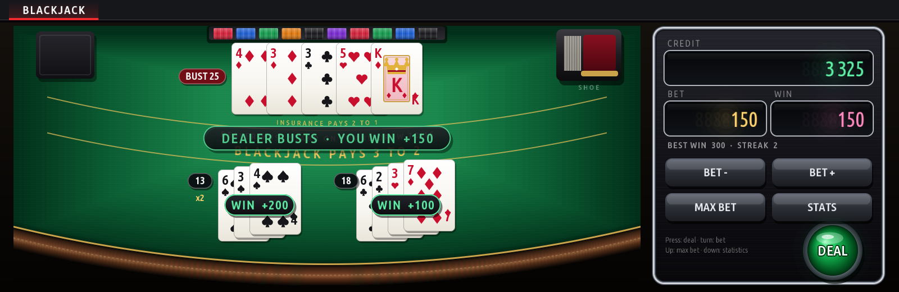

# BMW iDrive 7 Custom Apps (MGU)

Custom applications designed for BMW iDrive 7 (MGU head units) running on BMW PHEV models (B48 petrol engine + eDrive electric motor), plus five games for when the car is parked, compatible with **Robert Nisipeanu's mgu-store** and **IterioDev's App Manager**.

---

## 📱 Applications

### 1. ⚙️ Engine Care (`engine_care`)
*PHEV engine health and oil life intelligence monitor.*

BMW PHEV powertrains frequently start the combustion engine (ICE) directly while driving under hard acceleration, often when oil and coolant are completely cold. Standard BMW CBS (Condition Based Service) service intervals assume gentle highway mileage rather than intermittent short-cycle usage. **Engine Care** tracks real combustion engine telemetry to protect the engine:

* **Real Engine Operating Hours**: Tracks ICE runtime separate from EV driving.
* **ICE vs EV Mileage Split**: Percentage and absolute km driven on pure electric vs petrol.
* **Cold Hard-Start Counter**: Logs whenever the ICE starts while the engine oil is below the cold threshold (default < 65°C) and is then put under high torque load (default > 150 Nm) or above 3,200 rpm. The oil temperature comes from the CDS bus, or from the engine unit (OBD PID 5C) when the car doesn't send it there; the coolant temperature is the last fallback.
* **Real Distance**: Km since the oil change are read from the engine unit (OBD odometer PID A6, or PID 31), estimated from the speed only when it doesn't answer.
* **BMW CBS Side by Side**: Shows the instrument cluster's own oil service countdown (distance, date, overdue) next to your own target - for display only, as BMW's countdown is condition based and not a distance counter.
* **Engine Runs That Never Warmed the Oil**: Counts cold starts that stop again before the oil reaches its warm temperature (default 90°C) - the short PHEV runs that leave fuel and water in the oil.
* **Battery Charge at Engine Starts**: Splits engine starts into "the battery was at its reserve" and "it had charge left" (high-voltage battery charge read over UDS).
* **True Oil Life Monitor**: Whichever comes first of km, months and engine hours, where the engine hours include wear for cold starts, cold hard starts, runs that never warmed the oil and hot oil (so a hybrid that rarely runs its engine isn't charged twice for the same km).
* **Configurable Thresholds**: Customizable service limits (120h–250h or 6,000–15,000 km), cold / warm temperatures, load threshold, battery reserve.
* **Diagnostics Page** (setting): every signal with its age, the engine unit's raw UDS answers, the cluster's raw CBS data, whether the app counts with its screen closed and whether the torque signal includes the e-motor.
* **Drive Recording** (setting): one line a second of what the app got from the car, to replay on a PC (see Development).


<sub>Screenshots drawn by the app on a PC (`tools/screenshots.js`) with sample data.</sub>

### 2. ⚡ Hybrid Cost (`hybrid_cost`)
*Real-time running cost & energy split calculator.*

Compare the financial and energy efficiency of electric vs petrol driving live on your central display:

* **Live Cost per 100 km**: Real-time monetary cost (e.g. RON/100km, EUR/100km) based on instant fuel and electricity consumption.
* **Dynamic Powertrain Torque Split**: Live visual split between ICE and Electric motor torque.
* **Price Editor**: Tap a price (or press "Petrol Price" / "Elec Price") and set it with the iDrive controller (turn to change, press to save), +/- buttons or a numeric keypad. Without the GPU renderer, the buttons step through round prices for the chosen currency.
* **Multi-Currency Support**: RON, EUR, USD, GBP, CHF, PLN, HUF, CZK, SEK, NOK, DKK - each with typical prices and its own decimals; prices are kept separately for every currency.
* **Trip Cost Summary**: Financial tracking for current trip, last charge, and cumulative usage.


<sub>Screenshots drawn by the app on a PC (`tools/screenshots.js`) with sample data.</sub>

### 3. 🐍 Snake (`snake`)
*The classic game, drawn by the GPU renderer at 60 fps. Parked only.*

* **Smooth at any speed**: the snake slides between cells every frame (mgu-render); without the renderer it still runs as HMI images, a few frames a second.
* **iDrive controller**: push to go that way, turn to turn left / right, press to pause. Paused: push left leaves the app, a turn hands the controller back to the button bar and Settings.
* **Touchscreen**: swipe to steer, tap on the board to turn towards the tap, tap beside it to pause.
* **Settings**: speed (slow / normal / fast, faster with every food), edges (wrap around or solid walls), colour theme.
* **Best score** kept for each speed and edge setting.
* **Parked only**: pauses as soon as the car moves (above 3 km/h) and can't be started while driving.


<sub>Screenshot drawn by the app on a PC (`tools/screenshots.js`), a game played by an autopilot.</sub>

### 4. 🚀 Track Defender (`track_defender`)
*An arcade shooter: drones attack the track in waves, the M car shoots them down. GPU renderer at 60 fps. Parked only.*

* **Waves of drones**: they fly in on curves to a formation that sways and slowly sinks towards the track; some dive at the car and fire on the way. Heavy drones take two hits, every fifth wave is a boss drone.
* **Barriers** between the car and the drones crumble under the drones' fire; the car's own shots pass through.
* **The car fires by itself**: the **iDrive controller** drives it (turn = left / right, push left / right = a longer step), push up fires the **pulse** (clears the sky of bullets, hits every drone; charges again in 15 s), press pauses. On the **touchscreen** the car follows your finger, a tap on the pulse meter fires it.
* **Power-ups** from downed drones: double fire, a guard that takes one hit, an extra life.
* **Particle explosions, drifting stars, glowing shots** - all drawn by mgu-render every frame.
* **Settings**: difficulty (easy / normal / hard), colour theme. Best score kept for each difficulty.
* **Parked only**: pauses as soon as the car moves (above 3 km/h) and can't be started while driving.


<sub>Screenshot drawn by the app on a PC (`tools/screenshots.js`), a game played by an autopilot.</sub>

### 5. 🏁 Pit Wall (`pit_wall`)
*Break the advertising panels off the pit wall, catching the ball on an M front wing. A night race scene at 60 fps. Parked only.*

* **The scene**: floodlights over a grandstand full of camera flashes, glossy sponsor panels that shatter into shards, carbon panels that crack before they go, fuel cans that explode and take their neighbours with them (the screen shakes).
* **Start lights**: every level starts with five red lights; the ball goes when they go out.
* **The wing**: where the ball hits it sets the angle; the ball speeds up with every panel.
* **Combos**: panels in a row without touching the wing multiply the score (x2 .. x5).
* **Power-ups**: DRS (a wider wing), split (three balls), turbo (the ball burns through panels), slow ball, extra life.
* **Six walls** (Main Straight, The Wedge, Three Stripes, Chicane, Diamond, The Circuit), harder each round.
* **iDrive controller**: turn to move the wing, push left / right for a longer step, press to launch (or pause). **Touchscreen**: the wing follows your finger, tap to launch.
* **Settings**: ball speed (relaxed / normal / fast), colour theme. Best score kept for each ball speed.
* **Parked only**: pauses as soon as the car moves (above 3 km/h) and can't be started while driving.


<sub>Screenshot drawn by the app on a PC (`tools/screenshots.js`), a game played by an autopilot.</sub>

### 6. 🎰 Lucky Sevens (`lucky_sevens`)
*A five reel slot machine for play credits, drawn by the GPU renderer at 60 fps. Parked only.*

* **The machine**: a lacquered cabinet in a gold moulding with marquee bulbs, reels behind curved glass in a chrome bezel, glossy symbols lit from the top left (an extruded 7 with a gold rim, cherries, lemon, bell, BAR, a cut diamond, the WILD star), a control panel with LCD read-outs and a domed SPIN button.
* **Reels that feel real**: each winds up, runs with a motion blur, and stops one after the other with a small bounce; the bulbs chase round the machine while they run.
* **Ten paylines**, paid left to right from the first reel (cherries from two), **WILD** stands in for any symbol. A win lights its lines one by one, frames the symbols that pay (the higher ones in light rays), counts up into the credits; a big win throws a fountain of coins over the machine.
* **Free spins**: three WILDs anywhere in the window give **10 free spins** at the bet that won them, every win paid **x2**; WILDs again in a free spin give 10 more. They're announced, run by themselves, and the round ends with what it won.
* **Progressive jackpot**: every paid bet adds 1% to a pot (starting at 10 000) shown on the cabinet. **Five sevens on a line** (no WILD) win it: all of it at 50 per line, a share at a smaller bet. It comes on top of the line's own pay.
* **Statistics** (STATS key, or push the controller down): spins, credits bet and won, paid back %, best win, longest winning streak, free spin rounds, jackpots won, best jackpot, the jackpot at your bet.
* **Bet** 1 to 50 per line, **max bet**, **autoplay**; press while the reels run to stop them at once.
* **iDrive controller**: press = spin, turn = bet, push up = autoplay, push right = max bet, push down = statistics. **Touchscreen**: the panel's keys, or tap the reels to spin.
* **Play credits only**: nothing to buy, nothing to win. Out of credits, the SPIN button gives 1 000 new ones. The machine pays back about 96 of every 100 credits bet, free spins and jackpot included. Credits, bet, the jackpot, free spins left and the statistics are kept between drives.
* **Settings**: cabinet colour (ruby / sapphire / emerald / onyx), reel speed (normal / fast).
* **Parked only**: no spin while the car moves (above 3 km/h), autoplay goes off.





<sub>Screenshots drawn by the app on a PC (`tools/screenshots.js`), seeded spins.</sub>

### 7. 🃏 Blackjack (`blackjack`)
*Casino blackjack for play credits, drawn by the GPU renderer at 60 fps. Parked only.*

* **The table**: felt lit from above, a padded leather rail along its curved edge, the table's printing in gold along the arc, the dealer's chip rack, the shoe and the discard tray. Cards with real pips and court cards in a gold frame, casino chips in perspective.
* **Dealt like at the casino**: the cards fly from the shoe and settle in a fan, the dealer's hole card turns over, chips slide to the bet, winnings come from the dealer's rack, lost bets go to it, finished cards go to the discard tray.
* **Casino rules**: six decks shuffled again at the cut card, the dealer stands on 17 and peeks for blackjack, blackjack pays 3 to 2, double on any two cards (also after a split), split pairs up to four hands (split aces take one card), insurance pays 2 to 1.
* **Strategy hint** (setting): the key basic strategy plays lights up, and the panel says why (e.g. `11 vs 5 · TIP: DOUBLE`).
* **Statistics** (STATS key, or push the controller down): hands, won, lost, pushes, blackjacks, win rate, best win, longest winning streak, doubles and splits, paid back %.
* **iDrive controller**: betting: press = deal, turn = bet; playing: turn to choose HIT / STAND / DOUBLE / SPLIT and press, or push up = hit, down = stand, right = double, left = split. **Touchscreen**: the panel's keys.
* **Play credits only**: nothing to buy, nothing to win. Out of credits, DEAL gives 1 000 new ones. Credits, bet and statistics are kept between drives.
* **Settings**: table felt (green / blue / red / black), card backs (red / blue), dealing speed, strategy hint on / off.
* **Parked only**: no new hand while the car moves (above 3 km/h); a hand in play waits.



<sub>Screenshots drawn by the app on a PC (`tools/screenshots.js`), seeded hands played by basic strategy.</sub>

---

## 🚀 Installation

### Method 1: Via mgu-store (Recommended)
1. Open **Store** on your BMW central display.
2. Go to **Settings** -> **Add repository**.
3. Enter:
   ```text
   github.com/aurelmarius/bmw-apps
   ```
4. Select **Releases** as the source type.
5. Tap **Install** next to **Engine Care**, **Hybrid Cost**, **Snake**, **Track Defender**, **Pit Wall**, **Lucky Sevens** or **Blackjack**.

The games run smoothest with the **mgu-render** GPU renderer, installed from the same Store.

### Method 2: Via USB Stick
1. Download `engine_care@<version>.tgz`, `hybrid_cost@<version>.tgz`, `snake@<version>.tgz`, `track_defender@<version>.tgz`, `pit_wall@<version>.tgz`, `lucky_sevens@<version>.tgz` and `blackjack@<version>.tgz` from [Releases](https://github.com/aurelmarius/bmw-apps/releases).
2. Copy the files onto a USB stick or build a USB repository:
   ```powershell
   node mgu-install.js usb-repo E:\ engine_care@1.5.2.tgz hybrid_cost@1.1.2.tgz snake@1.0.0.tgz track_defender@1.0.0.tgz pit_wall@1.0.0.tgz lucky_sevens@1.1.0.tgz blackjack@1.0.0.tgz
   ```
3. Insert the USB drive into your car and install from the **USB** page of the Store.

### Method 3: Manual Deployment via SSH
Copy the package to the head unit and run `mgu-deploy.sh`:
```bash
/var/opt/mgu-deploy/mgu-deploy.sh install --artifact engine_care@1.5.2.tgz --yes
/var/opt/mgu-deploy/mgu-deploy.sh install --artifact hybrid_cost@1.1.2.tgz --yes
/var/opt/mgu-deploy/mgu-deploy.sh install --artifact snake@1.0.0.tgz --yes
/var/opt/mgu-deploy/mgu-deploy.sh install --artifact track_defender@1.0.0.tgz --yes
/var/opt/mgu-deploy/mgu-deploy.sh install --artifact pit_wall@1.0.0.tgz --yes
/var/opt/mgu-deploy/mgu-deploy.sh install --artifact lucky_sevens@1.1.0.tgz --yes
/var/opt/mgu-deploy/mgu-deploy.sh install --artifact blackjack@1.0.0.tgz --yes
```

---

## 🛠️ Technical Details

* **Platform**: BMW MGU (Media Graphics Unit) / iDrive 7
* **Framework**: Node.js OAP SDK (`oap-sdk`), BMW RHMI UI descriptions
* **Renderer**: Hardware-accelerated GPU canvas (`mgu-renderd` / `mgu-render`)
* **Signals**: BMW CDS & CDS2 bus, SOME/IP Vehicle & FES services; UDS over the head unit's diagnostic link (TASU) for the engine unit (oil temperature, distance) and the battery unit (charge)
* **Kit**: `kit/` is the [iDrive 7 custom apps](https://github.com/cauliflowermossgrape/idrive7-apps) kit (MIT), with this repo's packaging changes for mgu-store in `kit/tools/build.py`

---

## 🧪 Development

```bash
python3 kit/tools/build.py engine_care hybrid_cost snake track_defender pit_wall lucky_sevens blackjack  # -> dist/<id>@<version>.tgz
node kit/tools/preview.js dist/engine_care preview      # what the app draws, as PNGs (demo data)
node tests/engine_care.test.js                          # Engine Care's model
node tests/engine_care_app.test.js                      # the app on a simulated head unit
node tests/snake.test.js                                # Snake's rules
node tests/track_defender.test.js                       # Track Defender's rules
node tests/pit_wall.test.js                             # Pit Wall's rules
node tests/lucky_sevens.test.js                         # Lucky Sevens' rules
node tests/blackjack.test.js                            # Blackjack's rules
node tools/replay_engine_care.js engine_care_drive.jsonl --events   # a drive recorded in the car
node tools/screenshots.js                               # the README's screenshots (after a build)
```

Engine Care's bookkeeping is in `apps/engine_care/model.js`; `main.js` reads the car and draws. A drive recorded in the car (setting "Record drive data", file `engine_care_drive.jsonl` in the app's data folder) can be replayed with other settings, e.g. `--set warmTarget=85`.

**Releasing**: build, copy the new `dist/*.tgz` into `packages/` (remove the old version of that app) and push. The push of `packages/` runs the *Prepare Draft Release* workflow, which updates `catalog.json` and creates a draft release; publish the draft to make it visible in the Store.

---

## 📄 License
Custom BMW Community Apps. Created for educational and enthusiast vehicle monitoring purposes.
