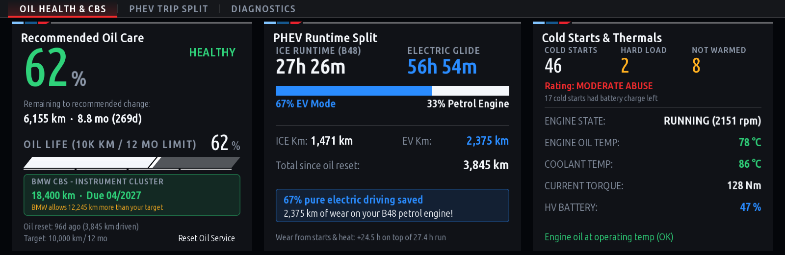
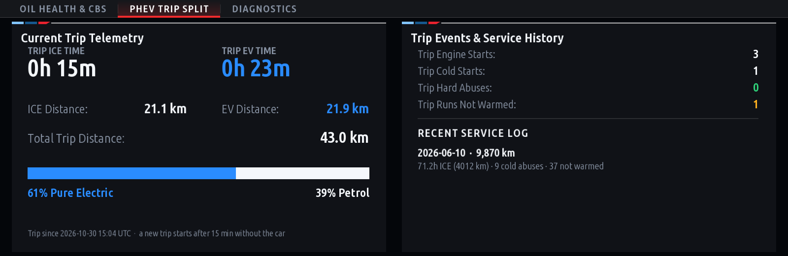
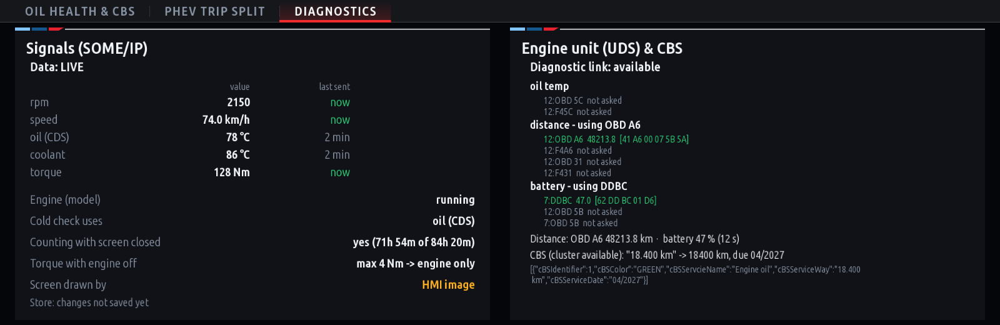
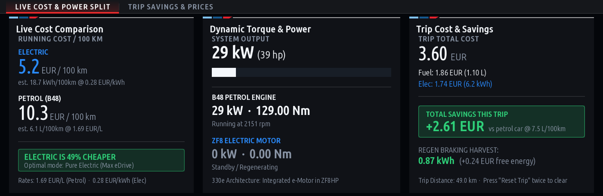
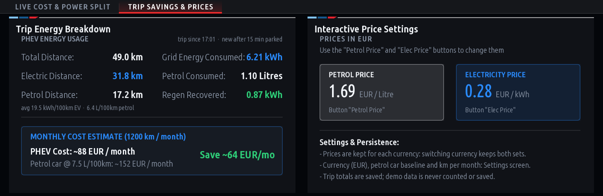
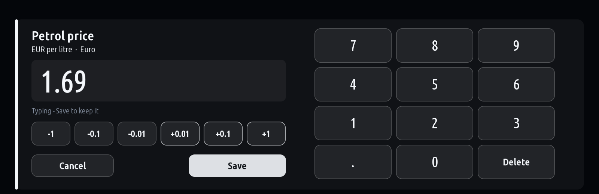
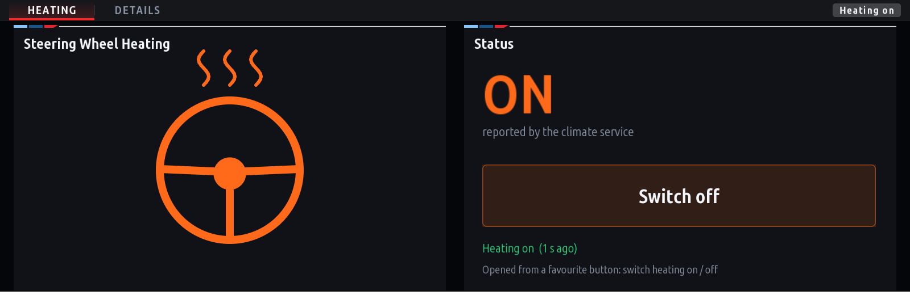
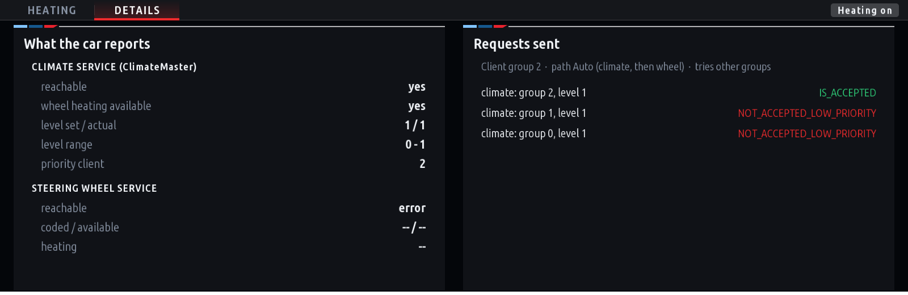
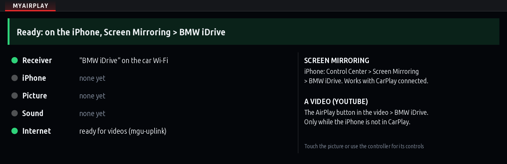
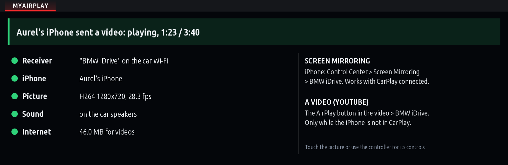

# BMW iDrive 7 Custom Apps (MGU)

Custom applications designed for BMW iDrive 7 (MGU head units) running on BMW PHEV models (B48 petrol engine + eDrive electric motor), compatible with **Robert Nisipeanu's mgu-store** and **IterioDev's App Manager**.

The games (Snake, Track Defender, Pit Wall, Lucky Sevens, Blackjack, Solitaire, Apex Chase, Street Siege) are in their own repository: **[aurelmarius/bmw-games](https://github.com/aurelmarius/bmw-games)** (add `aurelmarius/bmw-games` as a source in the Store).

---

## 📱 Applications

### 1. ⚙️ Engine Care (`aurelm_engine_care`)
*PHEV engine health and oil life intelligence monitor.*

BMW PHEV powertrains frequently start the combustion engine (ICE) directly while driving under hard acceleration, often when oil and coolant are completely cold. Standard BMW CBS (Condition Based Service) service intervals assume gentle highway mileage rather than intermittent short-cycle usage. **Engine Care** tracks real combustion engine telemetry to protect the engine:

* **Real Engine Operating Hours**: Tracks ICE runtime separate from EV driving.
* **ICE vs EV Mileage Split**: Percentage and absolute km driven on pure electric vs petrol.
* **Cold Hard-Start Counter**: Logs whenever the ICE starts while the engine oil is below the cold threshold (default < 65°C) and is then put under high torque load (default > 150 Nm) or above 3,200 rpm. The oil temperature comes from the CDS bus, or from the engine unit (OBD PID 5C) when the car doesn't send it there; the coolant temperature is the last fallback.
* **Real Distance**: Km since the oil change are read from the engine unit (OBD odometer PID A6, or PID 31), estimated from the speed only when it doesn't answer.
* **BMW CBS Side by Side**: Shows the instrument cluster's own oil service countdown (distance, date, overdue) next to your own target - for display only, as BMW's countdown is condition based and not a distance counter.
* **Engine Runs That Never Warmed the Oil**: Counts cold starts that stop again before the oil reaches its warm temperature (default 90°C) - the short PHEV runs that leave fuel and water in the oil.
* **Battery Charge at Engine Starts**: Splits engine starts into "the battery was at its reserve" and "it had charge left" (high-voltage battery charge read over UDS).
* **True Oil Life Monitor**: Whichever comes first of km, months and engine hours, where the engine hours include wear for cold starts, cold hard starts, runs that never warmed the oil and hot oil (so a hybrid that rarely runs its engine isn't charged twice for the same km).
* **Configurable Thresholds**: Customizable service limits (120h–250h or 6,000–15,000 km), cold / warm temperatures, load threshold, battery reserve.
* **Diagnostics Page** (setting): every signal with its age, the engine unit's raw UDS answers, the cluster's raw CBS data, whether the app counts with its screen closed and whether the torque signal includes the e-motor.
* **Drive Recording** (setting): one line a second of what the app got from the car, to replay on a PC (see Development).




<sub>Screenshots drawn by the app on a PC (`tools/screenshots.js`) with sample data.</sub>

### 2. ⚡ Hybrid Cost (`aurelm_hybrid_cost`)
*Real-time running cost & energy split calculator.*

Compare the financial and energy efficiency of electric vs petrol driving live on your central display:

* **Live Cost per 100 km**: Real-time monetary cost (e.g. RON/100km, EUR/100km) based on instant fuel and electricity consumption.
* **Dynamic Powertrain Torque Split**: Live visual split between ICE and Electric motor torque.
* **Price Editor**: Tap a price (or press "Petrol Price" / "Elec Price") and set it with the iDrive controller (turn to change, press to save), +/- buttons or a numeric keypad. Without the GPU renderer, the buttons step through round prices for the chosen currency.
* **Multi-Currency Support**: RON, EUR, USD, GBP, CHF, PLN, HUF, CZK, SEK, NOK, DKK - each with typical prices and its own decimals; prices are kept separately for every currency.
* **Trip Cost Summary**: Financial tracking for current trip, last charge, and cumulative usage.




<sub>Screenshots drawn by the app on a PC (`tools/screenshots.js`) with sample data.</sub>

### 3. 🔥 Wheel Heating (`aurelm_wheel_heat`)
*Steering wheel heating on/off from a favourite button.*

For an iDrive 7 car fitted with a heated iDrive 8 (LCI) steering wheel. That wheel has no heating button, and on iDrive 7 only the voice command could switch it. Tested in a G20 with iDrive 7.

* **Two tiles in the apps menu**:
  * **Wheel Heat On/Off** switches the heating without opening anything: you stay on the screen you were on. Put this one on a favourite button: highlight it in the apps menu and hold a favourite button (1-8). The first press after the head unit starts shows "Loading app" while the app starts. Setting: switch on / off, or always switch on.
  * **Wheel Heating** opens the status screen and switches nothing, so a heating the car switched on by itself in the cold stays on (setting: also switch, or always switch on).
* **Status screen**: on / off as the car reports it, with an on / off button.
* **Details page**: what the car reports and every request sent with the car's answer.
* **How it switches**: through the steering wheel's own service (`SteeringWheelClimate.requestHeating`). Where the head unit's climate service offers it (`ClimateMaster.requestSteeringWheelHeating`, as on iDrive 8 cars), that is tried first; a G20 with iDrive 7 doesn't offer it.
* **Why two tiles**: a tile the HMI opens a screen for always opens it, even from a favourite button, and an app can't take the HMI back to the screen you were on once its own screen is open. A tile with no screen opens nothing, but then the app can't open its screen from it either. So one tile does each (`app.json` `"entries"`, `"map": false`).



<sub>Screenshots drawn by the app on a PC with a simulated car.</sub>

### 4. 📺 myAirPlay (`aurelm_myairplay`) + myAirPlay service (`aurelm-myairplay`)
*The head unit as an AirPlay receiver for an iPhone.*

* **Screen mirroring**: on the iPhone, Control Center > Screen Mirroring > **BMW iDrive**. The iPhone's screen on the centre screen (decoded on the GPU, smooth, landscape fills the screen) and its sound on the car's speakers. **Works with wireless CarPlay connected.**
* **A video with the AirPlay button** (YouTube): the AirPlay button in the video > **BMW iDrive**. The head unit plays the video itself from the internet (mgu-uplink: an LTE stick, a USB modem or the iPhone's hotspot), up to 720p, with its sound on the speakers. Touch the picture or use the iDrive controller for its controls: -10 s, play / pause, +30 s, the picture's shape (fill, zoom, fit), and the progress bar. **Only while the iPhone is not in CarPlay**: iOS ends such a video when CarPlay is connected.
* **The picture shows while the car is parked** (setting, on by default; off: also while driving, for passengers). The iDrive controller's buttons hide a mirrored screen; leaving the app ends the mirroring, so CarPlay is free at once (setting).
* **Start AirPlay** makes the receiver run for an hour, and longer while an iPhone uses it. The service starts with the app (never at boot), opens its firewall ports only while the receiver runs, and leaves nothing behind when removed.
* Built on [UxPlay](https://github.com/FDH2/UxPlay) (GPL-3.0), with the GPU decoder from Moonride and FFmpeg. Developed and tested in the car as "AirPlay Test" in [bmw-test-apps](https://github.com/aurelmarius/bmw-test-apps). Details: [`native/aurelm-myairplay/README.md`](native/aurelm-myairplay/README.md).



<sub>Screenshots drawn by the app on a PC with a simulated service.</sub>

**Installing**: the Store installs the myAirPlay service with the app (it needs mgu-uplink for videos). **Restart the head unit once** after installing (the service listens for the app from the next start). If AirPlay Test from bmw-test-apps is installed, remove it and its service first: both use the same ports.

---

## 🚀 Installation

### Method 1: Via mgu-store (Recommended)
1. Open **Store** on your BMW central display.
2. Go to **Settings** -> **Add source**.
3. Enter:
   ```text
   aurelmarius/bmw-apps
   ```
4. Select **Releases** as the source type.
5. Tap **Install** next to **Engine Care**, **Hybrid Cost** or **Wheel Heating**.

**Installed Engine Care or Hybrid Cost from v1.5.9 or older?** The apps' ids now carry the `aurelm_` prefix (`aurelm_engine_care`, `aurelm_hybrid_cost`), as the Store's publishing guide asks and as in [bmw-games](https://github.com/aurelmarius/bmw-games), so the Store sees them as new apps: install them again, then remove the old ones (without the prefix) from the Store. Their data (Engine Care's hours and oil service, Hybrid Cost's trips and prices, the settings) starts afresh.

Publishing a release (its draft's *Publish release* button or the *Publish Release* workflow) turns every older release into a pre-release (`tools/retire_older_releases.sh`): the Store reads every published release, so an app renamed or moved would otherwise show twice.

### Method 2: Via USB Stick
1. Download the `aurelm_<app>@<version>.tgz` files from [Releases](https://github.com/aurelmarius/bmw-apps/releases).
2. Copy the files onto a USB stick or build a USB repository:
   ```powershell
   node mgu-install.js usb-repo E:\ aurelm_engine_care@1.5.2.tgz aurelm_hybrid_cost@1.1.2.tgz aurelm_wheel_heat@1.0.6.tgz
   ```
3. Insert the USB drive into your car and install from the **USB** page of the Store.

### Method 3: Manual Deployment via SSH
Copy the package to the head unit and run `mgu-deploy.sh`:
```bash
/var/opt/mgu-deploy/mgu-deploy.sh install --artifact aurelm_engine_care@1.5.2.tgz --yes
/var/opt/mgu-deploy/mgu-deploy.sh install --artifact aurelm_hybrid_cost@1.1.2.tgz --yes
/var/opt/mgu-deploy/mgu-deploy.sh install --artifact aurelm_wheel_heat@1.0.6.tgz --yes
```

---

## 🛠️ Technical Details

* **Platform**: BMW MGU (Media Graphics Unit) / iDrive 7
* **Framework**: Node.js OAP SDK (`oap-sdk`), BMW RHMI UI descriptions
* **Renderer**: Hardware-accelerated GPU canvas (`mgu-renderd` / `mgu-render`)
* **Signals**: BMW CDS & CDS2 bus, SOME/IP Vehicle & FES services; UDS over the head unit's diagnostic link (TASU) for the engine unit (oil temperature, distance) and the battery unit (charge)
* **Kit**: `kit/` is the [iDrive 7 custom apps](https://github.com/cauliflowermossgrape/idrive7-apps) kit (MIT), with this repo's packaging changes for mgu-store in `kit/tools/build.py`

---

## 🧪 Development

```bash
python3 kit/tools/build.py aurelm_engine_care aurelm_hybrid_cost  # -> dist/<id>@<version>.tgz
node kit/tools/preview.js dist/aurelm_engine_care preview      # what the app draws, as PNGs (demo data)
node tests/engine_care.test.js                          # Engine Care's model
node tests/engine_care_app.test.js                      # the app on a simulated head unit
node tests/aurelm_wheel_heat.test.js                    # Wheel Heating's switching against a simulated car
node tools/replay_engine_care.js engine_care_drive.jsonl --events   # a drive recorded in the car
node tools/screenshots.js                               # the README's screenshots (after a build)
```

Engine Care's bookkeeping is in `apps/aurelm_engine_care/model.js`; `main.js` reads the car and draws. A drive recorded in the car (setting "Record drive data", file `engine_care_drive.jsonl` in the app's data folder) can be replayed with other settings, e.g. `--set warmTarget=85`.

**Releasing**: build, copy the new `dist/*.tgz` into `packages/` (remove the old version of that app) and push. The push of `packages/` runs the *Prepare Draft Release* workflow, which updates `catalog.json` and creates a draft release; publish the draft to make it visible in the Store.

---

## 📄 License
Custom BMW Community Apps. Created for educational and enthusiast vehicle monitoring purposes.
